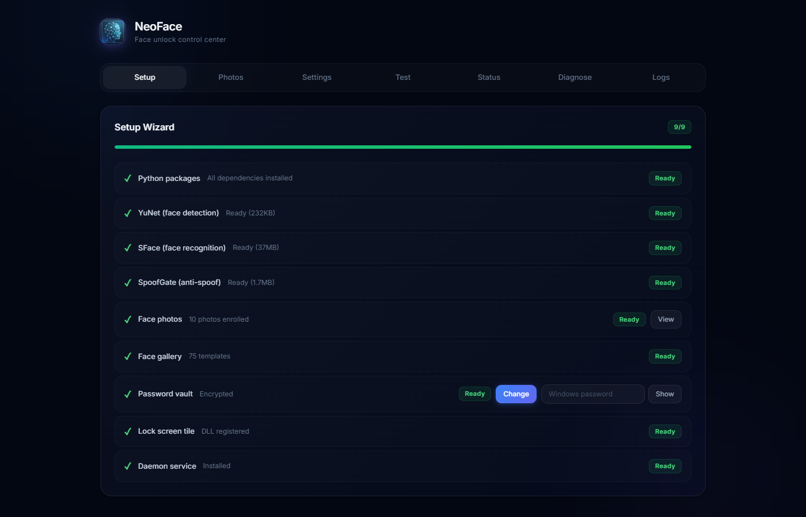
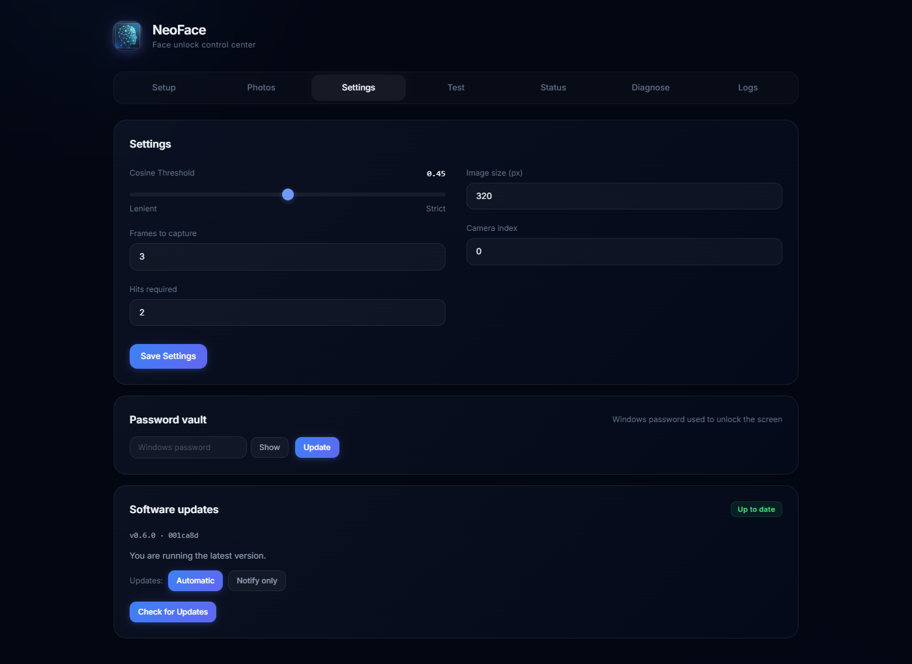
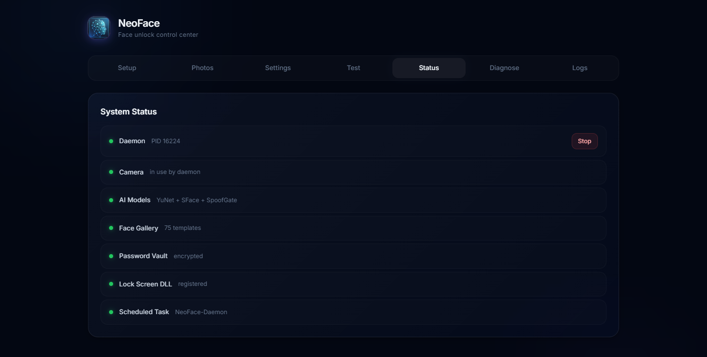

# NeoFace Unlock


**Open-source face unlock for any Windows laptop with a plain RGB webcam — no IR camera required.**

NeoFace adds a face unlock tile to the Windows lock screen: a C++ Credential Provider DLL talks to a Python daemon over a named pipe, and YuNet + SFace do detection and recognition in ~0.06 s per frame on CPU. Ships as a one-click installer (~70 MB, no Python/Git/compiler needed) with SHA256-verified automatic updates. Everything runs locally — no cloud, no telemetry, your face data never leaves your PC.

Built for my Predator Helios Neo 16 (i7-14700HX, RTX 4050, Win 11), but works on any Windows 10/11 x64 machine with a regular webcam.

## Screenshots

| Dashboard — Setup | Dashboard — Updates | Dashboard — Status |
|:--:|:--:|:--:|
|  |  |  |

<video src="https://github.com/user-attachments/assets/b54a2506-0e08-4a72-83cc-a583077f814d" controls="controls" muted="muted" autoplay="autoplay"></video>

## Features

- 🔓 **Any RGB webcam** — no IR camera, no special hardware; works where Windows Hello can't
- ⚡ **Fast** — YuNet detection + SFace recognition at ~0.06 s/frame on CPU (128-d templates)
- 🖥️ **Native lock-screen tile** — a real C++ Credential Provider (COM + `regsvr32`), not an autohotkey hack
- 🛡️ **Anti-spoofing** — MiniFASNet V2 model (print/replay rejection, fail-closed) + temporal motion liveness
- 🔐 **Local-only privacy** — face gallery and password vault encrypted with Windows DPAPI; no cloud, no telemetry
- 📦 **One-click installer** — `NeoFace-Setup.exe` (~70 MB) bundles a Python runtime; no Python, Git, or compiler needed
- 🌐 **Automatic updates** — one-click Update Now in the dashboard, or fully automatic with SHA256-verified downloads
- 🩺 **Self-service dashboard** — status, re-enrollment, troubleshoot, live logs, and diagnostics in a dark-glass UI
- ✅ **Tested** — 55-row API/unit test suite; every push builds the DLL + installer in CI

## NeoFace vs Windows Hello

|  | Windows Hello | NeoFace |
|---|---|---|
| Hardware | IR camera required | Any RGB webcam |
| Works on your laptop? | Only with IR hardware | Yes — that's the point |
| Liveness detection | Depth-based (strong) | Passive: MiniFASNet + motion analysis |
| Unlock path | Native biometric prompt | Lock-screen tile + click |
| Cost | Bundled with IR laptops | Free, works on existing hardware |

Honest take: if your laptop has an IR camera, Windows Hello is the stronger choice — depth-based liveness is genuinely better. NeoFace exists for the millions of laptops that don't have IR hardware, and as a fun open-source alternative you can actually read, audit, and modify.

## What's new in 0.6.0

- **One-click Update Now** — the dashboard downloads the new `NeoFace-Setup.exe` (SHA256-verified, staged safely) and applies it with live progress
- **Automatic updates** — choose *Automatic* once and updates apply silently in the background; *Notify only* keeps the old Yes/No prompt
- **What's new modal** — after an update, a modal shows the release notes for the version you just installed
- **Hourly update checks** — the scheduled task now checks hourly (was logon-only)

Full history: [CHANGELOG.md](CHANGELOG.md)

## Table of contents

- [How it works](#how-it-works)
- [Requirements](#requirements)
- [Install (one click)](#install-one-click)
- [Install from source (developers)](#install-from-source-developers)
- [Usage](#usage)
- [Auto-updates](#auto-updates)
- [Architecture](#architecture)
- [Performance](#performance)
- [Technical details](#technical-details)
- [Known limitations](#known-limitations)
- [Troubleshooting](#troubleshooting)
- [FAQ](#faq)
- [Roadmap](#roadmap)
- [Uninstall](#uninstall)
- [Security](#security)
- [Contributing](#contributing)
- [Acknowledgments](#acknowledgments)
- [License](#license)

## How it works

```
Win+L lock screen
  -> NeoFace tile appears (C++ Credential Provider DLL)
  -> Look at camera, click "Unlock with face"
  -> Daemon scans face (YuNet detection + SFace recognition, 0.06s/frame)
     + MiniFASNet anti-spoof + temporal motion liveness
  -> Match found -> desktop unlocked
  -> No match -> "Face not recognized" -> use PIN
```

The lock-screen DLL never touches the camera or models itself — it sends a `VERIFY` message through the named pipe `\\.\pipe\NeoFace` to the user-session daemon, which does the AI work and answers yes/no. The DLL packages the result into a Kerberos unlock pack.

## Requirements

- Windows 10/11 **x64**
- Any RGB webcam (USB or built-in)

That's it for the installer — no Python, no Git, no compiler.

## Install (one click)

1. Download **`NeoFace-Setup.exe`** from [Releases](https://github.com/Jaskaran9880/NeoFace/releases/latest) (about 70 MB)
2. Run it — if SmartScreen warns, click **More info → Run anyway** (the installer is unsigned)
3. The setup wizard then asks for your **Windows password once** (stored with DPAPI, locally) and walks you through **face enrollment** with the camera
4. Sign in with PIN, press **Win+L**, click the **NeoFace** tile, look at the camera

Start Menu after install: **NeoFace → Dashboard** (status/troubleshoot), **Setup Wizard** (re-enroll), **Test Unlock**.

> **Verifying your download**: every release asset is built by GitHub Actions on a `v*` tag, and the SHA256 checksum is published in the [release notes](https://github.com/Jaskaran9880/NeoFace/releases/latest). Verify it with:
> ```powershell
> certutil -hashfile NeoFace-Setup-0.6.0.exe SHA256
> ```
> Updates applied from the dashboard verify this checksum automatically and refuse to install on mismatch.

## Install from source (developers)

Needs [Python 3.10+](https://python.org), Git, and [VS2022 Build Tools](https://visualstudio.microsoft.com/downloads) (Desktop C++ workload) for the C++ DLL.

> `requirements.txt` is the **full/dev** set (includes the optional `onnxruntime` + `insightface` accurate engine and `PySide6`). The installer ships `requirements-runtime.txt` instead — a 6-package runtime with the fast YuNet/SFace engine only. Install from source with the full set unless you know you want the lean one.

### Manual install

```powershell
# 1. Clone and install dependencies
git clone https://github.com/Jaskaran9880/NeoFace.git
cd NeoFace
pip install -r requirements.txt

# 2. Download face detection/recognition models
python tools\fetch_fast.py

# 3. Add your face photos
#    Place front-facing photos (JPG/PNG/HEIC) in the photos\ folder

# 4. Enroll your face
python tools\enroll_fast.py

# 5. Set up password vault (one-time, your Windows password)
python tools\set_password_machine.py

# 6. Build and register the lock screen tile (Admin)
cd cp
.\build_cp.ps1
.\register_cp.ps1
cd ..

# 7. Install daemon service (Admin)
.\installer\install_daemon.ps1

# 8. Test
python tools\test_unlock.py
```

### Run the test suite

```powershell
python tests\test_dashboard_api.py                                  # read-only checks + unit tests
$env:NEOFACE_TEST_DESTRUCTIVE = "1"; python tests\test_dashboard_api.py   # + opt-in live/ destructive rows
```

55 rows: unit tests for the updater/notifier/AI helpers plus live API checks against the dashboard. Destructive rows are opt-in and back up + restore everything they touch. See the header of [tests/test_dashboard_api.py](tests/test_dashboard_api.py) for the full list.

## Usage

1. Log in with PIN once (daemon starts automatically at logon)
2. Press **Win+L** to lock
3. Look at the camera
4. Click **"Unlock with face"** on the NeoFace tile
5. Unlocked!

## Auto-updates

NeoFace updates itself — no manual re-downloads. The **Settings → Software updates** card shows your version, the latest release, and an **Automatic / Notify only** toggle.

- **One-click Update Now**: when an update is available, one click downloads the new `NeoFace-Setup.exe` straight from GitHub Releases, verifies its SHA256 against the checksum published in the release notes, and applies it — with live progress (downloading → verifying → installing) in the dashboard. A double-click guard prevents two updates from racing.
- **Automatic mode**: updates apply silently in the background (at most once per version). Installed builds restart the daemon automatically after install; git clones get a prompt to restart.
- **Notify only mode**: a Yes/No dialog appears when you're behind; **No** declines that version permanently (dedupe per SHA, max 1 prompt/24h).
- **What's new modal**: after updating, a modal shows the release notes of the version you just installed — rendered through an HTML-escaping allowlist renderer.
- **Hourly checks**: the `NeoFace-UpdateCheck` task checks GitHub hourly and shortly after logon (installer installs; source installs register logon-only — re-run `.\installer\install_daemon.ps1` after this release to graft the hourly trigger); the dashboard also refreshes every hour and when you refocus its tab.
- **Two install flavors, one pipeline**: git clones update via `git pull --ff-only` (origin re-verified against an allow-list); installed builds (no git) download the SHA256-pinned setup.exe — both paths work with the same toggle.
- **Opt out** (Admin): `Disable-ScheduledTask -TaskName NeoFace-UpdateCheck`
- Test manually: `python tools\update_notifier.py --test` (or `--check-only`, `--answer yes|no`); logs land in `update_notifier.log`

## Architecture

```
NeoFace/
  face_unlock/
    daemon_pipe.py      - Named pipe daemon (runs as pythonw, hidden)
    fast.py             - YuNet + SFace engine (0.06s/frame, 128-d)
    engine.py           - InsightFace buffalo_l (optional, 512-d)
    store.py            - DPAPI encrypted face gallery
    matcher.py          - Cosine similarity scoring
    camera.py           - DSHOW camera with MJPG codec
    camera_warmup.py    - Settle/warmup logic after sleep/wake
    antispoof.py        - SpoofGate anti-spoofing (MiniFASNet V2, fail-closed)
    liveness.py         - Temporal motion liveness (photo/replay rejection)
    updater.py          - Self-update pipeline (SHA256, staging, apply, rollback)
    auth.py, daemon.py, presence.py,
    presence_daemon.py, service.py - Support modules
  cp/
    dllmain.cpp         - C++ DLL entry + COM factory
    provider.cpp        - Credential Provider (tile UI)
    credential.cpp      - Tile logic + pipe communication
    kerb.cpp            - Kerberos unlock packager
    README.md           - Credential Provider field-schema notes
  tools/
    enroll_fast.py      - Enroll from photos + video
    test_unlock.py      - Test face scan
    fetch_fast.py       - SHA256-pinned model downloader
    set_password_machine.py - Store Windows password (DPAPI)
    setup_wizard.py     - First-run wizard (vault + enrollment + test scan)
    update_notifier.py  - Logon/hourly notifier + auto-apply engine
    apply_update.ps1    - Elevated apply helper (UAC fallback)
  tests/
    test_dashboard_api.py - 55-row live API + unit suite (opt-in destructive)
    test_camera.py       - Camera behavior tests
  docs/
    SECURITY.md          - Threat model + vault security notes
    FLOW.md, dev/        - Design and development docs
  .github/workflows/
    ci.yml               - Builds the C++ DLL + installer on every push/PR
    release.yml          - v* tag -> NeoFace-Setup.exe published to Releases
                         (SHA256 in the release notes)
  dashboard.py           - Flask dashboard (status, photos, troubleshoot, updates)
  templates/index.html   - Dashboard UI (Tailwind dark glass)
  installer/             - Inno Setup script, post-install, build_dist
  CHANGELOG.md           - Release history
  config.example.toml    - Config template (config.toml is not tracked)
  models/                - yunet.onnx (232KB), sface.onnx (37MB), antifas_v2.onnx
  photos/                - Your face photos (for enrollment)
```

## Performance

| Backend | Speed | Dimensions | Accuracy | GPU needed |
|---------|-------|------------|----------|------------|
| **fast** (default) | 0.06s/frame | 128-d | Good (0.54-0.73) | No |
| accurate (optional) | 2.6s/frame | 512-d | Best | Optional |

## Technical details

- **Detection**: YuNet (OpenCV DNN, CPU-optimized)
- **Recognition**: SFace (OpenCV FaceRecognizerSF)
- **Anti-spoofing**: MiniFASNet V2 (ONNX, fail-closed — rejects when the model can't load) + temporal motion liveness
- **Gallery**: Variable-length vectors, NF02 format, DPAPI encrypted
- **Pipe protocol**: Message-mode named pipe (`\\.\pipe\NeoFace`)
- **Lock screen tile**: C++ Credential Provider (registered via COM + regsvr32)
- **Daemon**: Python scheduled task, Interactive logon type
- **Update integrity**: release assets are SHA256-pinned; downloads stage to `.part` and only atomically replace the target after verification; the release origin is allow-listed and re-verified at apply time; a failed apply rolls back

## Known limitations

- Camera requires user session (Windows blocks SYSTEM access at login screen)
- PIN required once per boot/wake; face unlock available for all subsequent locks
- Keep PIN enabled as backup
- Anti-spoofing is passive (model + motion analysis); depth-based liveness like Windows Hello's is stronger

## Troubleshooting

| Problem | Fix |
|---------|-----|
| SmartScreen says "protected your PC" | More info → **Run anyway** (the installer is unsigned) — then verify the SHA256 from the release notes if you want |
| Want to re-enroll or re-run setup | Start Menu → NeoFace → **Setup Wizard** |
| Updates not appearing | Check the Settings → Software updates card; installed builds update via GitHub Releases (no git needed). Logs: `update_notifier.log` |
| Update prompt doesn't appear | Automatic mode applies silently; in Notify mode a declined version never re-prompts — check `update_notifier.log` |
| "Camera not available" | Stop the daemon first (`Stop-ScheduledTask -TaskName NeoFace-Daemon`), then try again |
| "Pipe not available" | Start the daemon: `Start-ScheduledTask -TaskName NeoFace-Daemon` |
| "Face not recognized" | Re-enroll: `python tools\enroll_fast.py`, ensure good lighting |
| Camera opens slowly | Normal for DSHOW backend (~2-3s first open), subsequent opens are faster |
| Daemon not starting | Check `C:\ProgramData\NeoFace\daemon.log` for errors |
| DLL not showing on lock screen | Re-register: `regsvr32 "C:\Program Files\NeoFace\FaceUnlockCP.dll"` |
| No logo on the NeoFace tile | Re-run `.\cp\deploy_all.ps1` (or `register_cp.ps1`) so `icon.bmp`/`tile.bmp` land in `C:\Program Files\NeoFace` |

## FAQ

**Is it secure?**
Face unlock here is a convenience feature, not a security boundary — same as Windows Hello in spirit. NeoFace adds passive anti-spoofing (print/replay rejection) and encrypts everything with DPAPI, but keep your PIN enabled as the real fallback. See [docs/SECURITY.md](docs/SECURITY.md) for the threat model.

**Does it work alongside Windows Hello?**
Yes. They coexist — NeoFace registers an additional credential provider, so Hello keeps working. NeoFace is most useful on laptops without an IR camera, where Hello face unlock isn't available.

**What data leaves my PC?**
Nothing. Face templates, photos, and the password vault are stored locally (DPAPI-encrypted). The only network traffic is update checks against GitHub.

**macOS / Linux support?**
No — this is Windows-only by design (it's a Windows Credential Provider).

**Why does SmartScreen warn about the installer?**
It's unsigned (code-signing certificates cost money). The installer is built publicly by GitHub Actions from this repo's source, and the SHA256 is published in the release notes — verify it with `certutil -hashfile`.

## Roadmap

- Active liveness detection (interactive challenge — e.g. blink/turn prompts)
- QML FaceID-style unlock ring animation
- Adaptive thresholds (per-user, per-lighting)

Track progress in [CHANGELOG.md](CHANGELOG.md) and [open issues](https://github.com/Jaskaran9880/NeoFace/issues).

## Uninstall

**Installer installs**: Start Menu → NeoFace → Uninstall (or Windows Settings → Apps). Keeps `C:\ProgramData\NeoFace` (faces/vault) so a reinstall works.

**Clone installs**: run either of these **as Admin** (both raise a UAC prompt if needed):

```bat
uninstall.bat                        (double-click, repo root)
```
```powershell
.\installer\uninstall.ps1              (Admin terminal)
.\installer\uninstall.ps1 -Purge       (Admin terminal, also wipes user data)
```

It removes the lock-screen DLL (and tile), all NeoFace scheduled tasks, running processes, and shortcuts. It keeps `C:\ProgramData\NeoFace` (face gallery, vault, logs) unless you pass `-Purge`; the repo folder itself is untouched. If LogonUI holds the DLL, deletion is scheduled for the next reboot. A removed/kept summary is printed at the end.

## Security

See [docs/SECURITY.md](docs/SECURITY.md) for the threat model, update-integrity design, password vault security notes, and known limitations.

Found a vulnerability? Please open a [private security advisory](https://github.com/Jaskaran9880/NeoFace/security/advisories/new) rather than a public issue.

## Contributing

See [CONTRIBUTING.md](CONTRIBUTING.md) for development setup and code style guidelines. Run the [test suite](#run-the-test-suite) before opening a PR — CI builds the DLL and installer on every push.

## Acknowledgments

- [YuNet](https://github.com/opencv/opencv_zoo/tree/main/models/face_detection_yunet) face detection — Jianzhu Guan, OPPO Research Institute (MIT, via OpenCV model zoo)
- [SFace](https://github.com/opencv/opencv_zoo/tree/main/models/face_recognition_sface) recognition — Alexander Uspenko et al., Sberbank AI Lab (Apache-2.0, via OpenCV)
- [MiniFASNet](https://github.com/minivision-ai/Silent-Face-Anti-Spoofing) anti-spoofing — MiniVision AI (the `antifas_v2.onnx` model)
- [OpenCV](https://opencv.org) — the DNN/runtime backbone
- [InsightFace](https://github.com/deepinsight/insightface) — optional accurate engine (its pretrained models carry a non-commercial research license; they are not bundled with NeoFace)

## License

[MIT](LICENSE) — free to use, modify, and redistribute. `Copyright (c) 2026 NeoFace`.
